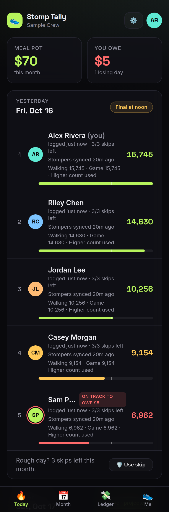
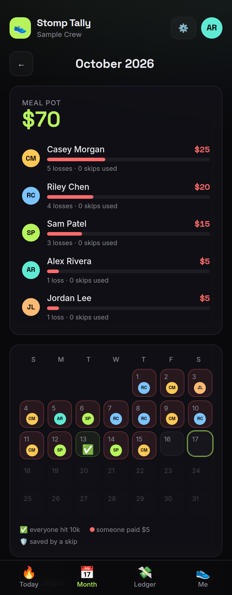
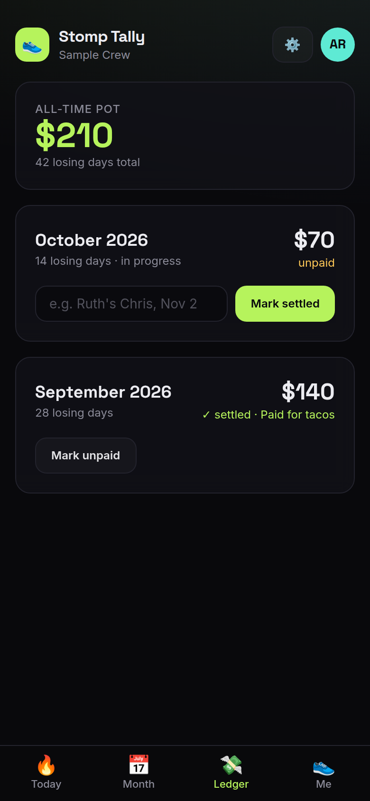
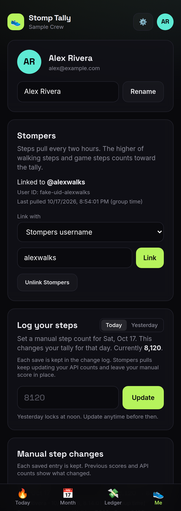
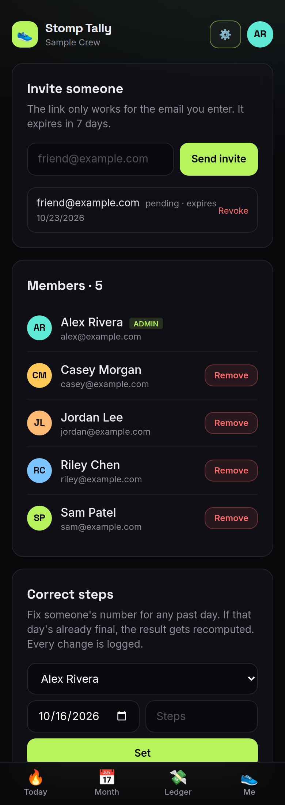

# Stomp Tally

Daily step stakes for a friend group. Link a [Stompers](https://stompers.com) username or user ID on Me. Every two hours, the app pulls walking steps and item-adjusted game steps. The higher count scores the day, including fractional game steps. Each day, whoever has the fewest steps **and** is under 10,000 owes $5 toward the monthly group meal.

Invite-only. Email magic-link login, no passwords. Runs on Cloudflare Workers + D1 (free tier is plenty for a handful of people).

## Screenshots

All data below is invented. Regenerate with `node scripts/screenshots.mjs`.

<table>
  <tr>
    <td align="center"><br><b>Today</b></td>
    <td align="center"><br><b>Month</b></td>
    <td align="center"><br><b>Ledger</b></td>
  </tr>
  <tr>
    <td align="center"><br><b>Me</b></td>
    <td align="center"><br><b>Group (admin)</b></td>
    <td></td>
  </tr>
</table>

## Rules

- Lowest steps under the goal (default 10,000) owes the penalty (default $5). Exactly 10,000 is safe.
- Ties at the lowest: everyone tied pays.
- No entry for the day counts as 0 steps.
- Linked accounts keep their last successful counts when the API fails. Missing or stale API data delays locking instead of generating a zero-step penalty. An explicit manual fallback or admin correction can still lock.
- Both imported counts appear on Today and Month. An admin correction overrides the imported score; later pulls still refresh the two API counts.
- Manual step entry lives on Me. Each save creates a separate immutable manual entry and an audit event with the previous score and API snapshot. The manual score overrides that day's tally while scheduled pulls continue updating both API counts. Members see their own change history on Me; admins see their group's history on Group.
- Each person logs their own steps for today, or yesterday until it locks. Days lock at **12:00 noon the next day** (group timezone), then only an admin can correct them.
- **Skips:** 3 per person per calendar month, claimed manually before the day locks. A skip is only used up if it actually saves you from paying. Otherwise it's released. A used skip never moves the penalty to someone else.
- An admin can correct any past day. Correcting a locked day recomputes it.

## Stack

React Router v8 (SSR) · Cloudflare Workers · D1 (SQLite) · Cron Trigger (two-hour sync and finalize) · Tailwind v4 · Resend (email) · Vitest

## Layout

```
app/lib/rules.ts        pure money logic (who pays), unit-tested
app/lib/service.ts      write-side business logic, takes a tiny Db interface
app/lib/stompers.server.ts account links, validated API reads, scheduled imports
app/lib/pages.ts        one SQL statement per page, including session and group lookup
app/lib/views.ts        pure view builders, no database calls
app/lib/db.ts           Db interface + D1 adapter with request-scoped timing
app/lib/dates.ts        timezone / lock-time helpers
app/lib/mail.server.ts  Resend sender (logs to console when no API key)
app/routes/             pages: today, month, history (ledger), me, group (admin), login, invite, setup
workers/app.ts          Worker entry: security headers + two-hour sync before finalize
migrations/             D1 schema
scripts/smoke.sh        end-to-end HTTP smoke test against `npm run dev`
scripts/screenshots.mjs seeds a throwaway local DB with fake data and renders screenshots/
```

## Develop

Requires Node 22.13+ (Node 22 is pinned in `.nvmrc` and CI). Use `nvm use` if you have nvm installed.

```bash
npm ci
cp .dev.vars.example .dev.vars          # local-only secrets, git-ignored
npx wrangler d1 migrations apply stomp-tally --local
npm run dev                              # http://localhost:5173
```

With no `RESEND_API_KEY`, emails are printed to the dev server console instead of sent, so you can copy login and invite links from there. Open `/setup` first (it asks for `SETUP_KEY` from `.dev.vars`) to create the admin.

## Test

```bash
npm test             # rules + service tests (real SQLite via node:sqlite, using the real migration)
npm run typecheck
npm run build
```

End-to-end smoke test on a throwaway local database (needs Node 22+):

```bash
P=$(mktemp -d); LOG=$P/dev.log
npx wrangler d1 migrations apply stomp-tally --local --persist-to "$P"
STOMP_PERSIST=$P npm run dev -- --port 5173 --strictPort > "$LOG" 2>&1 &
DEV_PID=$!
# Wait for the dev server's "Local:" message before running these:
LOG=$LOG bash scripts/smoke.sh
LOG=$LOG node scripts/pending-browser.mjs # requires Chromium
kill "$DEV_PID"
```

## Deploy

One-time setup (auth with `wrangler login`, or a scoped `CLOUDFLARE_API_TOKEN`):

```bash
npx wrangler d1 create stomp-tally          # copy the database_id into wrangler.jsonc
npx wrangler d1 migrations apply stomp-tally --remote
npx wrangler secret put SETUP_KEY           # you'll type this on /setup to create the first admin
npx wrangler secret put RESEND_API_KEY
npm run deploy
```

Then open `https://<your-domain>/setup`, create the admin, and invite people from the ⚙️ Group page.

- The domain in `wrangler.jsonc` (`routes` and `APP_URL`) must be on your Cloudflare account. `MAIL_FROM` must be on a domain verified in Resend (SPF/DKIM).
- `/setup` is disabled until `SETUP_KEY` is set, and locks permanently once any user exists.
- Schema changes: add a new `migrations/000N_*.sql`, apply with `--remote`. Never edit an applied migration.

## Security notes

- Login and invite tokens are random, stored only as SHA-256 hashes, and single-use. The login-link page needs a button press, so email link scanners can't burn the token.
- An invite is bound to one email. Accepting it sends a confirm link to that address, and membership is only granted if the logged-in email matches.
- Login, setup and invite endpoints are rate-limited (Workers rate-limit binding).
- No secrets live in the repo. `.dev.vars` is git-ignored; production secrets are Wrangler secrets.

## Performance

Each main page uses **one SQL statement and one D1 round trip**, including authentication. A CTE resolves the session and group, and separate JSON-aggregated subqueries fetch the datasets without multiplying rows. The shared layout uses the child page's result instead of doing another lookup.

`pages.test.ts` enforces the one-call limit and tests expired sessions, cross-group isolation and timezone/month boundaries. Responses include `X-DB-Calls`, `X-DB-Statements` and `Server-Timing` so latency can be verified on the deployed Worker. Smart Placement is enabled; it may take time to learn a better location.

This budget applies to page reads, not mutations (writes may need validation and a transaction).

## Loading feedback

Navigation and form submissions immediately show a loading overlay. Continue shows “Logging you in…” through the login POST and redirect; form buttons show a spinner and disable repeat submissions. The page behind the overlay is inert for pointer and keyboard input. Automatic background refresh stays silent.

Browser regression checks hold real requests open (without mocking responses) and verify success, error recovery, duplicate taps, redirects and background refresh:

```bash
LOG=/path/to/dev-server.log node scripts/pending-browser.mjs
```

Run after `scripts/smoke.sh` against its local fixture. Uses Chromium at `/usr/bin/chromium`, or set `CHROMIUM`. The tests never use a production account.

## Stompers reads

Cron runs at minute 5 of every even UTC hour (`5 */2 * * *`). It resolves
`USER_UID_friends`, reads `current_game_uid`, and fetches the current game.
It also reads recent games and caches known game IDs so yesterday can be
refreshed before the noon lock, even when the history list omits it.
Only today/yesterday, after joining the group, are imported. Finalized days
remain unchanged. API games must span one full local day in the group timezone;
both counts must be valid numbers. A linked API entry must have a successful
pull within 30 minutes of finalization. Failed days are retried at the next run.

The tested profile/room/game routes currently need no auth token. This is an
undocumented API and can change. Only linked group members are polled.
Linking identifies an account; it does not prove ownership of that Stompers
account. Do not use this as authentication.

The one-time links for the five original signed-up users are in
`scripts/stompers-seed.sql`. Apply after the migrations with
`npx wrangler d1 execute stomp-tally --remote --file scripts/stompers-seed.sql`.
It checks the original user IDs and names and never overwrites existing links.

## Not built yet

- Screenshot upload as a dispute fallback.
